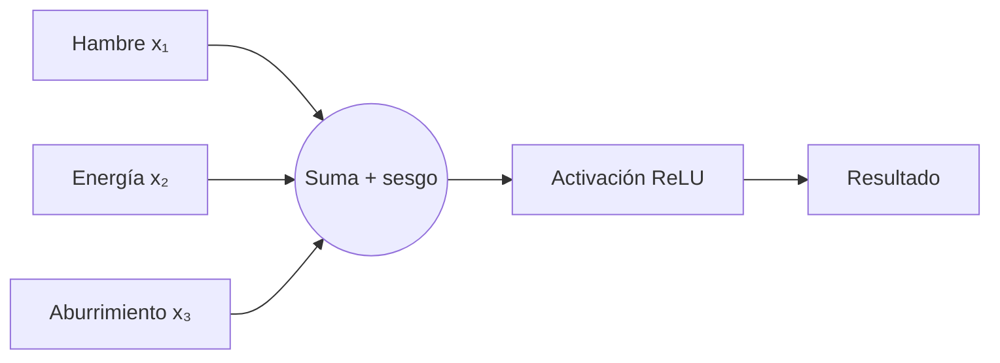
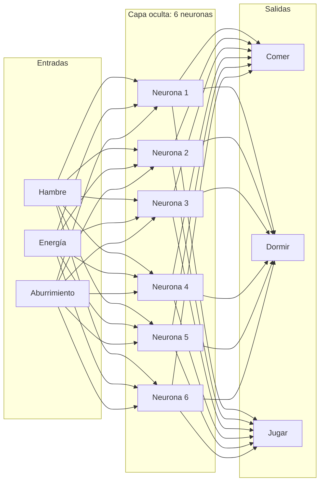
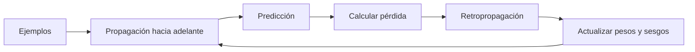

# Neurito: una mascota virtual con cerebro artificial

Neurito es una mascota virtual con tres necesidades: **hambre, energía y aburrimiento**. Su cerebro, una red neuronal construida desde cero con **NumPy**, aprende a decidir entre **comer, dormir y jugar**. Después, **Pygame** presenta la decisión mediante indicadores y sprites animados.

El objetivo es comprender qué hace una neurona artificial, cómo se conectan varias neuronas, cómo se ajustan los pesos durante el entrenamiento y cómo una predicción numérica puede controlar el comportamiento visible de un programa.

## 1. El problema: ¿qué necesita Neurito?

Neurito observa tres valores entre 0 y 1:

| Entrada | 0 significa | 1 significa |
|---|---|---|
| Hambre | Nada de hambre | Mucha hambre |
| Energía | Sin energía | Energía completa |
| Aburrimiento | Nada aburrido | Muy aburrido |

Por ejemplo, si tiene **hambre = 0.75**, **energía = 0.20** y **aburrimiento = 0.40**, presenta bastante hambre, pero también mucho cansancio. El modelo deberá identificar qué acción tiene prioridad.

Las tres acciones que puede predecir son:

- **Comer:** ante hambre dominante.
- **Dormir:** ante cansancio dominante (energía baja).
- **Jugar:** ante aburrimiento dominante.

La red aprende esta correspondencia utilizando situaciones de ejemplo. **No utiliza una cadena de `if`/`else` para elegir entre esas tres acciones durante el juego**: su elección procede de los valores calculados por las neuronas. Más adelante se incorpora una regla independiente para mostrar el estado visual *neutral*.

## 2. De una neurona biológica a una artificial

Una neurona artificial recibe números llamados **entradas**, multiplica cada uno por un **peso**, suma los resultados y un **sesgo**, y transforma el valor obtenido con una **función de activación**.



Su cálculo es:

$$
z=x_1w_1+x_2w_2+x_3w_3+b
$$

- $x_1,x_2,x_3$: entradas de la mascota.
- $w_1,w_2,w_3$: pesos que determinan la influencia de cada entrada.
- $b$: sesgo, que desplaza el resultado de la suma.
- $z$: resultado antes de la activación.

Una **función de activación** permite introducir transformaciones no lineales. Utilizaremos **ReLU**:

$$
\operatorname{ReLU}(z)=\max(0,z)
$$

Si $z$ es negativo, su salida será 0; si es positivo, conserva ese valor.

### Ejemplo resuelto, paso a paso

Supongamos las entradas y pesos siguientes:

| Valor | Número |
|---|---:|
| Hambre ($x_1$) | 0.8 |
| Energía ($x_2$) | 0.2 |
| Aburrimiento ($x_3$) | 0.5 |
| Peso $w_1$ | 0.7 |
| Peso $w_2$ | -0.5 |
| Peso $w_3$ | 0.3 |
| Sesgo $b$ | 0.1 |

Sustituimos en la fórmula:

$$
z=(0.8\times0.7)+(0.2\times-0.5)+(0.5\times0.3)+0.1
$$

$$
z=0.56-0.10+0.15+0.10=0.71
$$

Como $0.71$ es positivo, la activación entrega **0.71**.

```python
# Entradas de Neurito
hambre = 0.8
energia = 0.2
aburrimiento = 0.5

# Pesos elegidos para este primer ejemplo
w1 = 0.7
w2 = -0.5
w3 = 0.3

# Sesgo
b = 0.1

# Suma ponderada
z = hambre * w1 + energia * w2 + aburrimiento * w3 + b

# Activación ReLU
salida = max(0, z)
print("Resultado de la neurona:", salida)
```

La salida **no significa todavía «71 % de probabilidad de comer»**. Es únicamente la activación de **una** neurona. Para decidir entre tres acciones necesitamos una red con varias neuronas y tres salidas.

## 3. Construir una red neuronal: 3 → 6 → 3

Una **red neuronal** conecta las salidas de unas neuronas con las entradas de otras. Neurito usa esta arquitectura:



La **capa de entrada** representa tres datos y no realiza cálculos neuronales por sí misma. La **capa oculta** tiene seis neuronas con ReLU. La **capa de salida** tiene tres neuronas cuyos resultados se transforman mediante Softmax.

Los pesos y sesgos se organizan en matrices:

| Variable | Forma | Para qué sirve |
|---|---|---|
| `W1` | `(3, 6)` | Conecta las 3 entradas con las 6 neuronas ocultas |
| `b1` | `(1, 6)` | Sesgo de cada neurona oculta |
| `W2` | `(6, 3)` | Conecta las 6 neuronas ocultas con las 3 salidas |
| `b2` | `(1, 3)` | Sesgo de cada salida |

Los valores iniciales de los pesos son aleatorios. La red todavía **no sabe** qué acción corresponde a cada situación: deberá aprenderlo ajustándolos.

## 4. Propagación hacia adelante: calcular una respuesta

La **propagación hacia adelante** (*forward propagation*) transforma los datos de entrada en una predicción. Con NumPy, `@` representa multiplicación matricial:

```python
z1 = datos @ W1 + b1

a1 = relu(z1)

z2 = a1 @ W2 + b2

a2 = softmax(z2)
```

Primero se calculan las seis activaciones ocultas; después se calculan las tres salidas.

**Softmax** transforma los tres resultados de salida en valores positivos que suman 1:

$$
\operatorname{softmax}(z_i)=\frac{e^{z_i}}{\sum_j e^{z_j}}
$$

Por ejemplo, la red podría devolver:

| Acción | Valor de Softmax |
|---|---:|
| Comer | 0.70 |
| Dormir | 0.20 |
| Jugar | 0.10 |

En ese caso, elegimos **comer**, porque tiene el mayor valor. Son **probabilidades predichas por el modelo**, no garantías de que la decisión sea correcta ni porcentajes de necesidad. Para seleccionar el índice de mayor valor utilizamos `np.argmax()`.

## 5. ¿De dónde salen los ejemplos de entrenamiento?

Para que la red aprenda, necesitamos situaciones con una acción esperada. En este proyecto se generan **3000 casos sintéticos**:

```python
np.random.seed(42)
X = np.random.rand(3000, 3)
```

La semilla `42` permite reproducir la misma secuencia de números aleatorios. Cada fila de `X` tiene los valores de hambre, energía y aburrimiento.

Para construir las **etiquetas correctas** de esos ejemplos utilizamos una política sencilla:

$$
\text{prioridades}=[\text{hambre},\;1-\text{energía},\;\text{aburrimiento}]
$$

¿Por qué $1-\text{energía}$? Porque para decidir si debe dormir necesitamos medir el **cansancio**: una energía de 0.2 equivale a un cansancio de 0.8.

| Hambre | Energía | Aburrimiento | Prioridades: comer, dormir, jugar | Etiqueta |
|---:|---:|---:|---|---|
| 0.9 | 0.8 | 0.2 | [0.9, 0.2, 0.2] | Comer |
| 0.2 | 0.1 | 0.4 | [0.2, 0.9, 0.4] | Dormir |
| 0.1 | 0.9 | 0.8 | [0.1, 0.1, 0.8] | Jugar |

El código que crea las etiquetas es:

```python
necesidades = np.column_stack((
    X[:, 0],
    1 - X[:, 1],
    X[:, 2]
))

y = np.argmax(necesidades, axis=1)
```

Aquí sí existe una **regla explícita**, pero se utiliza **para preparar ejemplos de entrenamiento**, no para seleccionar directamente las acciones dentro del juego. La red intenta aprender a reproducir esa regla a partir de los datos.

## 6. Entrenar: errores, pérdida y retropropagación

Al comienzo, los pesos aleatorios generan respuestas imperfectas. El entrenamiento repite un ciclo:



### 6.1 Función de pérdida

La **entropía cruzada** (*cross-entropy*) mide qué tan mal el modelo asigna probabilidad a la acción correcta:

$$
L=-\frac{1}{N}\sum_{i=1}^{N}\log(p_{i,y_i})
$$

Aquí $N$ es el número de ejemplos y $p_{i,y_i}$ es la probabilidad que el modelo asignó a la clase correcta del ejemplo $i$.

Si la respuesta correcta es **comer**, un modelo que asigne `0.95` a comer tendrá menor pérdida que uno que asigne `0.10` a comer. La pérdida no es lo mismo que el porcentaje de aciertos: también refleja cuánta probabilidad se asigna a las respuestas correctas.

```python
perdida = -np.mean(
    np.log(a2[np.arange(n), y] + 1e-10)
)
```

El pequeño valor `1e-10` evita calcular el logaritmo de cero.

### 6.2 Retropropagación

La **retropropagación** (*backpropagation*) calcula cómo debe cambiar cada peso y cada sesgo para reducir la pérdida. Lo hace utilizando derivadas y la regla de la cadena.

Primero se calculan los gradientes de la capa de salida (`dz2`, `dW2`, `db2`); después se propaga esa información a la capa oculta (`dz1`, `dW1`, `db1`). En ReLU, la derivada es 1 si la entrada es positiva y 0 si es negativa; en el código se representa con `(z1 > 0)`.

### 6.3 Descenso de gradiente

Para actualizar un peso utilizamos:

$$
w_{\text{nuevo}}=w_{\text{anterior}}-\eta\frac{\partial L}{\partial w}
$$

Donde $\eta$ es la **tasa de aprendizaje**. En nuestro proyecto vale `0.1`: controla el tamaño de cada actualización, no el porcentaje de información aprendida.

```python
W1 -= tasa_aprendizaje * dW1
b1 -= tasa_aprendizaje * db1
W2 -= tasa_aprendizaje * dW2
b2 -= tasa_aprendizaje * db2
```

Una **época** es una pasada por todos los ejemplos de entrenamiento. Realizamos `1200` épocas. El modelo utiliza los 3000 ejemplos en cada actualización: es un entrenamiento de **lote completo** (*full-batch gradient descent*).

## 7. Evaluar: ¿aprendió la red?

Después del entrenamiento se generan **1000 situaciones nuevas** con valores aleatorios. Para cada una comparamos la clase predicha con la que establece la misma política utilizada para crear las etiquetas.

$$
\text{precisión}=\frac{\text{predicciones correctas}}{\text{total de situaciones}}
$$

```python
precision = np.mean(predicciones == respuestas)
print(f"Precisión en situaciones nuevas: {precision:.2%}")
```

Por ejemplo, una precisión de **99.40 %** indicaría que acertó en 994 de las 1000 situaciones de prueba. El valor concreto puede depender de los parámetros y del entrenamiento. Esta evaluación demuestra qué tan bien imita la **política sintética**, pero no que sea una inteligencia general ni que haya aprendido las necesidades reales de una mascota.

## 8. Conectar la predicción a una mascota animada

Pygame crea la ventana, muestra tres barras y dibuja una imagen de Neurito según la decisión de la red. Cada estado tiene imágenes PNG que se alternan:

| Estado visual | Sprites |
|---|---|
| Neutro | `neutral_1.png`, `neutral_2.png`, `neutral_3.png` |
| Comer | `comer_1.png`, `comer_2.png` |
| Dormir | `dormir_1.png`, `dormir_2.png` |
| Jugar | `jugar_1.png`, `jugar_2.png` |

Los frames cambian cada **500 milisegundos**. La expresión del personaje responde a su estado, pero las imágenes **no son datos de entrenamiento** de la red neuronal.

**Importante:** el estado *neutral* no es una cuarta salida de la red. Se muestra mediante una regla adicional cuando el hambre es menor que `0.4`, la energía mayor que `0.6` y el aburrimiento menor que `0.4`. En las demás situaciones se utiliza la acción predicha. Por eso el modelo sigue teniendo **tres salidas**.

## 9. Preparar y ejecutar el proyecto

Se utilizarán **Python**, **NumPy**, **pygame-ce** y el gestor de proyectos **uv**. `pygame-ce` se instala con ese nombre, pero se importa en Python como `pygame`.

```bash
uv init neurito
cd neurito
uv add numpy pygame-ce
```

Estructura esperada:

```text
neurito/
├── assets/
│   ├── comer_1.png
│   ├── comer_2.png
│   ├── dormir_1.png
│   ├── dormir_2.png
│   ├── jugar_1.png
│   ├── jugar_2.png
│   ├── neutral_1.png
│   ├── neutral_2.png
│   └── neutral_3.png
├── main.py
├── pyproject.toml
└── uv.lock
```

**Recursos gráficos:** Los PNG se encuentran en la carpeta [`assets/`](./assets/). También pueden abrirse y guardarse individualmente desde estos enlaces:

| Estado | Imagen 1 | Imagen 2 | Imagen 3 |
|---|---|---|---|
| Neutro | [neutral_1.png](./assets/neutral_1.png) | [neutral_2.png](./assets/neutral_2.png) | [neutral_3.png](./assets/neutral_3.png) |
| Comer | [comer_1.png](./assets/comer_1.png) | [comer_2.png](./assets/comer_2.png) | — |
| Dormir | [dormir_1.png](./assets/dormir_1.png) | [dormir_2.png](./assets/dormir_2.png) | — |
| Jugar | [jugar_1.png](./assets/jugar_1.png) | [jugar_2.png](./assets/jugar_2.png) | — |

Estos enlaces relativos funcionarán en GitHub cuando la carpeta `assets` se publique junto con este README. No es necesario comprimir los recursos.

Ejecutar desde la carpeta principal:

```bash
uv run main.py
```

Controles del juego:

| Tecla | Acción |
|---|---|
| `H` / `J` | Aumentar / disminuir hambre |
| `E` / `D` | Aumentar / disminuir energía |
| `A` / `S` | Aumentar / disminuir aburrimiento |
| `R` | Crear una situación aleatoria |
| `N` | Recuperar el estado tranquilo |
| `Esc` | Salir |

## 10. Experimentar con el cerebro de Neurito

Una forma de comprobar qué aprendió la red es modificar una variable mientras se mantienen fijas las otras dos. Después, probar situaciones donde dos necesidades son casi iguales: ¿cómo cambia la predicción? ¿Qué probabilidades aparecen?

También podemos cambiar `ocultas = 6` por `3`, `10` o `20`, comparar el valor de pérdida y la precisión, y estudiar cómo afecta una arquitectura más grande o más pequeña. Otra prueba es modificar `epocas = 1200` o `tasa_aprendizaje = 0.1` y observar si el entrenamiento converge igual.

Preguntas para analizar los resultados:

1. ¿Qué diferencia existe entre programar directamente una decisión y enseñar a una red neuronal mediante ejemplos?
2. ¿Por qué se utiliza `1 - energia` para preparar los datos?
3. ¿Qué representan los pesos y los sesgos?
4. ¿Por qué se necesita ReLU en la capa oculta y Softmax en la salida?
5. ¿Cómo sabemos que una disminución en la pérdida representa una mejora?
6. ¿Por qué una precisión alta no significa que el modelo pueda resolver cualquier problema?
7. ¿Qué necesitaríamos cambiar para que la red también aprendiera a elegir el estado neutro?

## 11. Código final completo: `main.py`

El siguiente archivo contiene el entrenamiento desde cero, la evaluación, la carga de sprites, la animación y la interfaz de Neurito. Se puede copiar directamente en `main.py`.

```python

from pathlib import Path

import numpy as np
import pygame


# ===================================
# 1. Preparar datos de entrenamiento
# ===================================

np.random.seed(42)

# Generamos 3000 situaciones posibles.
# Cada fila contiene hambre, energia y aburrimiento.
X = np.random.rand(3000, 3)

# Creamos las decisiones correctas.
# 0 = comer, 1 = dormir, 2 = jugar.
necesidades = np.column_stack((
    X[:, 0],
    1 - X[:, 1],
    X[:, 2]
))

y = np.argmax(necesidades, axis=1)


# ===================================
# 2. Crear la red neuronal
# ===================================

# Arquitectura: 3 entradas, 6 ocultas, 3 salidas.
entradas = 3
ocultas = 6
salidas = 3

# Pesos y sesgos iniciales.
W1 = np.random.randn(entradas, ocultas) * 0.5
b1 = np.zeros((1, ocultas))

W2 = np.random.randn(ocultas, salidas) * 0.5
b2 = np.zeros((1, salidas))


# ===================================
# 3. Funciones de activación
# ===================================

def relu(x):
    # Convierte los valores negativos en cero.
    return np.maximum(0, x)


def softmax(x):
    # Transforma las salidas en probabilidades.
    e = np.exp(x - np.max(x, axis=1, keepdims=True))
    return e / np.sum(e, axis=1, keepdims=True)


# ===================================
# 4. Propagación hacia adelante
# ===================================

def predecir(datos):
    # Primera capa.
    z1 = datos @ W1 + b1
    a1 = relu(z1)

    # Segunda capa.
    z2 = a1 @ W2 + b2
    a2 = softmax(z2)

    return a2


# ===================================
# 5. Entrenar la red neuronal
# ===================================

tasa_aprendizaje = 0.1
epocas = 1200

for epoca in range(epocas):

    # Propagación hacia adelante.
    z1 = X @ W1 + b1
    a1 = relu(z1)

    z2 = a1 @ W2 + b2
    a2 = softmax(z2)

    # Calcular la pérdida.
    n = len(X)

    perdida = -np.mean(
        np.log(a2[np.arange(n), y] + 1e-10)
    )

    # Retropropagación: capa de salida.
    dz2 = a2.copy()
    dz2[np.arange(n), y] -= 1
    dz2 /= n

    dW2 = a1.T @ dz2
    db2 = np.sum(dz2, axis=0, keepdims=True)

    # Retropropagación: capa oculta.
    da1 = dz2 @ W2.T
    dz1 = da1 * (z1 > 0)

    dW1 = X.T @ dz1
    db1 = np.sum(dz1, axis=0, keepdims=True)

    # Actualizar pesos y sesgos.
    W1 -= tasa_aprendizaje * dW1
    b1 -= tasa_aprendizaje * db1

    W2 -= tasa_aprendizaje * dW2
    b2 -= tasa_aprendizaje * db2

    if epoca % 200 == 0:
        print(f"Época {epoca} | Error: {perdida:.4f}")


# ===================================
# 6. Evaluar la red neuronal
# ===================================

prueba = np.random.rand(1000, 3)

necesidades_prueba = np.column_stack((
    prueba[:, 0],
    1 - prueba[:, 1],
    prueba[:, 2]
))

respuestas = np.argmax(necesidades_prueba, axis=1)
predicciones = np.argmax(predecir(prueba), axis=1)

precision = np.mean(predicciones == respuestas)

print(f"Precisión en situaciones nuevas: {precision:.2%}")


# ===================================
# 7. Configurar Pygame
# ===================================

pygame.init()

ANCHO = 900
ALTO = 600

pantalla = pygame.display.set_mode((ANCHO, ALTO))
pygame.display.set_caption("Neurito - Mascota con cerebro artificial")

reloj = pygame.time.Clock()

fuente = pygame.font.SysFont(None, 34)
fuente_pequena = pygame.font.SysFont(None, 24)
fuente_titulo = pygame.font.SysFont(None, 40)

# Carpeta que contiene nuestros sprites.
RUTA_ASSETS = Path(__file__).resolve().parent / "assets"

# Tamaño de las imágenes en pantalla.
TAMANO_MASCOTA = (350, 350)


# ===================================
# 8. Cargar imágenes de la mascota
# ===================================

def cargar_imagen(nombre):
    # Buscar el archivo en la carpeta assets.
    ruta = RUTA_ASSETS / nombre

    # Cargar PNG conservando su transparencia.
    imagen = pygame.image.load(str(ruta)).convert_alpha()

    # Ajustar el tamaño de la imagen.
    imagen = pygame.transform.smoothscale(
        imagen,
        TAMANO_MASCOTA
    )

    return imagen


# Cada estado contiene los frames de su animación.
animaciones = {
    "neutral": [
        cargar_imagen("neutral_1.png"),
        cargar_imagen("neutral_2.png"),
        cargar_imagen("neutral_3.png")
    ],
    "comer": [
        cargar_imagen("comer_1.png"),
        cargar_imagen("comer_2.png")
    ],
    "dormir": [
        cargar_imagen("dormir_1.png"),
        cargar_imagen("dormir_2.png")
    ],
    "jugar": [
        cargar_imagen("jugar_1.png"),
        cargar_imagen("jugar_2.png")
    ]
}


# ===================================
# 9. Configurar las animaciones
# ===================================

# Tiempo que permanece cada imagen (milisegundos).
VELOCIDAD_ANIMACION = 500

# Estado visual inicial.
estado_actual = "neutral"

# Índice de la imagen que estamos mostrando.
frame_actual = 0

# Momento del último cambio de imagen.
ultimo_cambio = pygame.time.get_ticks()


def actualizar_animacion(nuevo_estado):
    global estado_actual
    global frame_actual
    global ultimo_cambio

    # Tiempo actual de Pygame en milisegundos.
    ahora = pygame.time.get_ticks()

    # Si cambia el estado, reiniciamos la animación.
    if nuevo_estado != estado_actual:
        estado_actual = nuevo_estado
        frame_actual = 0
        ultimo_cambio = ahora

    # Si transcurrieron 500 ms, avanzamos de imagen.
    elif ahora - ultimo_cambio >= VELOCIDAD_ANIMACION:

        # Pasar a la siguiente imagen.
        # El módulo (%) permite regresar al principio.
        frame_actual = (
            frame_actual + 1
        ) % len(animaciones[estado_actual])

        # Guardar el momento del cambio.
        ultimo_cambio = ahora

    # Devolver la imagen correspondiente.
    return animaciones[estado_actual][frame_actual]


# ===================================
# 10. Estado inicial de la mascota
# ===================================

hambre = 0.2
energia = 0.9
aburrimiento = 0.2

acciones = ["comer", "dormir", "jugar"]


# ===================================
# 11. Dibujar indicadores
# ===================================

def dibujar_barra(nombre, valor, y, color):

    texto = fuente_pequena.render(
        f"{nombre}: {valor * 100:.0f}%",
        True,
        (35, 40, 55)
    )
    pantalla.blit(texto, (55, y - 30))

    # Fondo de la barra.
    pygame.draw.rect(
        pantalla,
        (215, 220, 230),
        (55, y, 300, 24),
        border_radius=8
    )

    # Barra de progreso.
    pygame.draw.rect(
        pantalla,
        color,
        (55, y, int(300 * valor), 24),
        border_radius=8
    )


# ===================================
# 12. Determinar el estado visual
# ===================================

def obtener_estado(hambre, energia, aburrimiento, decision):

    # Si sus necesidades están satisfechas,
    # mostramos el estado neutro.
    #
    # Esta condición no pertenece a la red neuronal.
    # Es una regla adicional para la interfaz.
    if (
        hambre < 0.4
        and energia > 0.6
        and aburrimiento < 0.4
    ):
        return "neutral"

    # En los demás casos utilizamos
    # la decisión de la red neuronal.
    return acciones[decision]


# ===================================
# 13. Juego principal
# ===================================

ejecutando = True

while ejecutando:

    # -----------------------------------
    # Procesar eventos del teclado
    # -----------------------------------

    for evento in pygame.event.get():

        if evento.type == pygame.QUIT:
            ejecutando = False

        if evento.type == pygame.KEYDOWN:

            if evento.key == pygame.K_ESCAPE:
                ejecutando = False

            # Modificar el hambre.
            if evento.key == pygame.K_h:
                hambre = min(1, hambre + 0.1)

            if evento.key == pygame.K_j:
                hambre = max(0, hambre - 0.1)

            # Modificar la energía.
            if evento.key == pygame.K_e:
                energia = min(1, energia + 0.1)

            if evento.key == pygame.K_d:
                energia = max(0, energia - 0.1)

            # Modificar el aburrimiento.
            if evento.key == pygame.K_a:
                aburrimiento = min(1, aburrimiento + 0.1)

            if evento.key == pygame.K_s:
                aburrimiento = max(0, aburrimiento - 0.1)

            # Generar un estado aleatorio.
            if evento.key == pygame.K_r:
                hambre, energia, aburrimiento = np.random.rand(3)

            # Recuperar el estado tranquilo.
            if evento.key == pygame.K_n:
                hambre = 0.2
                energia = 0.9
                aburrimiento = 0.2

    # -----------------------------------
    # Consultar la red neuronal
    # -----------------------------------

    estado = np.array([[
        hambre,
        energia,
        aburrimiento
    ]])

    probabilidades = predecir(estado)[0]

    # Elegir la salida con mayor probabilidad.
    decision = int(np.argmax(probabilidades))

    # Determinar qué estado debemos mostrar.
    nuevo_estado = obtener_estado(
        hambre,
        energia,
        aburrimiento,
        decision
    )

    # Actualizar el frame de la animación.
    imagen_mascota = actualizar_animacion(nuevo_estado)

    # -----------------------------------
    # Dibujar interfaz
    # -----------------------------------

    pantalla.fill((250, 245, 252))

    titulo = fuente_titulo.render(
        "NEURITO - MI CEREBRO ARTIFICIAL",
        True,
        (65, 50, 85)
    )
    pantalla.blit(titulo, (55, 30))

    # Indicadores de necesidades.
    dibujar_barra(
        "Hambre", hambre, 130, (240, 150, 75)
    )

    dibujar_barra(
        "Energia", energia, 225, (65, 180, 115)
    )

    dibujar_barra(
        "Aburrimiento", aburrimiento, 320, (110, 135, 240)
    )

    # -----------------------------------
    # Mostrar mascota animada
    # -----------------------------------

    posicion_mascota = imagen_mascota.get_rect(
        center=(660, 245)
    )

    pantalla.blit(
        imagen_mascota,
        posicion_mascota
    )

    # Mostrar el estado actual.
    texto_estado = fuente.render(
        f"Estado: {nuevo_estado.upper()}",
        True,
        (90, 65, 110)
    )

    rect_estado = texto_estado.get_rect(
        center=(660, 440)
    )

    pantalla.blit(texto_estado, rect_estado)

    # -----------------------------------
    # Mostrar predicciones de la red
    # -----------------------------------

    for i, nombre in enumerate(acciones):

        texto = fuente_pequena.render(
            f"{nombre.upper()}: {probabilidades[i] * 100:.1f}%",
            True,
            (65, 60, 80)
        )

        pantalla.blit(
            texto,
            (55, 400 + i * 30)
        )

    # -----------------------------------
    # Mostrar controles
    # -----------------------------------

    ayuda1 = fuente_pequena.render(
        "H/J: Hambre +/-     E/D: Energia +/-",
        True,
        (90, 90, 110)
    )

    ayuda2 = fuente_pequena.render(
        "A/S: Aburrimiento +/-     R: Aleatorio",
        True,
        (90, 90, 110)
    )

    ayuda3 = fuente_pequena.render(
        "N: Estado neutro     ESC: Salir",
        True,
        (90, 90, 110)
    )

    pantalla.blit(ayuda1, (55, 500))
    pantalla.blit(ayuda2, (55, 530))
    pantalla.blit(ayuda3, (55, 560))

    # Actualizar la pantalla.
    pygame.display.flip()

    # Mantener 30 fotogramas por segundo.
    reloj.tick(30)

pygame.quit()

```
